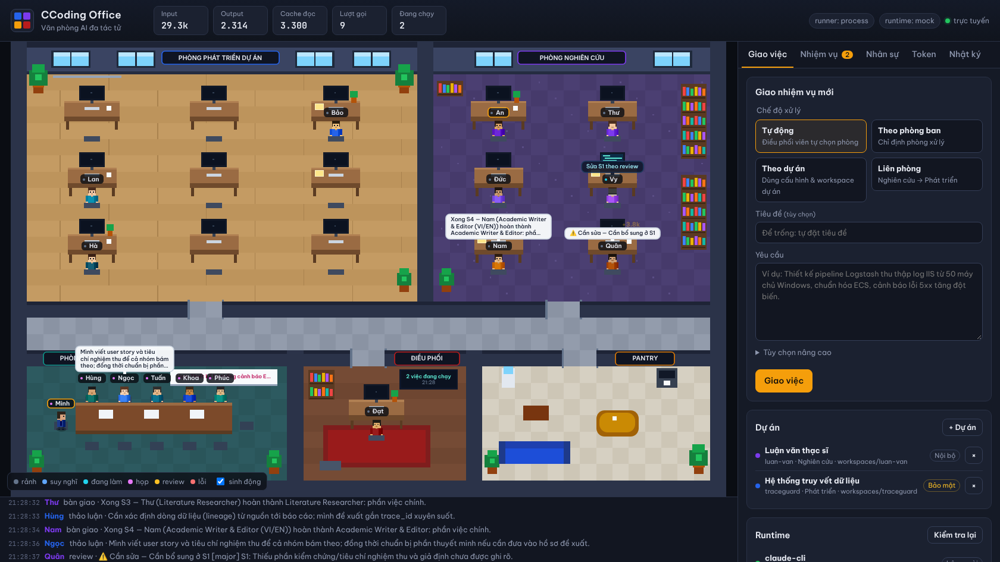
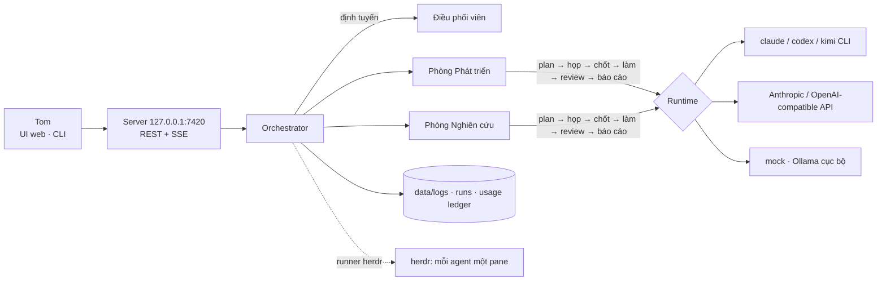

# CCoding Office 🏢

**Văn phòng AI đa tác tử** chạy trên máy của bạn: một *Điều phối viên* nhận việc, giao cho **trưởng phòng**, các **sub-agent** tự họp thảo luận, chia việc, làm song song, review lẫn nhau rồi nộp báo cáo. Mọi lượt làm việc được **ghi log theo từng vị trí** và **đếm token in/out** theo agent, phòng ban, nhiệm vụ, dự án. Chạy nền bằng **[herdr](https://herdr.dev)** — tắt terminal, các agent vẫn làm việc.



## Tính năng

- **2 phòng ban, 16 nhân sự** (mỗi người một `agent.md` riêng, viết dựa trên skill của Tom + kinh nghiệm cộng đồng):
  - 🔵 **Phòng Phát triển Dự án** (công việc): Trưởng phòng, Kiến trúc sư giải pháp, Backend, Frontend, Data Engineer (ELK), DevOps/SRE, ATTT & Bảo vệ dữ liệu, BA & Pre-sales, QA.
  - 🟣 **Phòng Nghiên cứu** (học thuật): Trưởng phòng (PI), Literature Researcher, Data Scientist, Methodologist, Academic Writer, Peer Reviewer.
  - 🔴 **Điều phối viên** định tuyến nhiệm vụ.
- **4 chế độ xử lý**: *Tự động* (điều phối viên chọn phòng) · *Theo phòng ban* · *Theo dự án* (workspace, runtime, phân loại dữ liệu, ngân sách riêng) · *Liên phòng* (Nghiên cứu → Phát triển).
- **Quy trình như một phòng ban thật**: lập kế hoạch → họp thảo luận (agent đi vào phòng họp, phát biểu, @nhắc nhau) → chốt → thực thi song song theo phụ thuộc → review & sửa → báo cáo tổng hợp.
- **Log theo vị trí** (`data/logs/agents/<id>.jsonl`), theo phòng ban, theo nhiệm vụ; có **chuỗi băm** để phát hiện chỉnh sửa (`ccoding logs verify`).
- **Bộ đếm token** cho từng lượt gọi: input, output, cache đọc/ghi, chi phí — tổng hợp theo agent / phòng / task / dự án / model / ngày (UI, CLI `ccoding usage --watch`, và hiển thị trên sidebar herdr).
- **Nhiều runtime**: Claude Code CLI, Codex CLI, Kimi Code CLI, Anthropic API, API tương thích OpenAI (9router, Ollama, OpenRouter…), và `mock` để chạy thử offline.
- **Data Protection Gate tích hợp**: nhãn dữ liệu theo dự án quyết định runtime nào được nhận dữ liệu; tự che khóa bí mật/PII trước khi ghi log hay gửi ra ngoài.
- **Giao diện văn phòng pixel** (thời gian thực qua SSE) + **CLI** đầy đủ.

## Kiến trúc



Chi tiết: [docs/ARCHITECTURE.md](docs/ARCHITECTURE.md).

## Cài đặt nhanh

Yêu cầu: **Node.js ≥ 22**, Git. (Windows: PowerShell 5+.)

```powershell
git clone https://github.com/tom18072001/CCoding.git
cd CCoding
npm install          # cài phụ thuộc + build (dist/)
node dist/cli.js doctor
node dist/cli.js serve   # mở http://127.0.0.1:7420
```

Thử ngay không tốn token:

```powershell
node dist/cli.js task "Thiết kế pipeline Logstash thu log IIS, chuẩn hóa ECS, cảnh báo 5xx" --runtime mock --wait
```

> Muốn gõ `ccoding …` thay cho `node dist/cli.js …`: chạy `npm link` một lần.

## Chạy nền bằng herdr

```powershell
# cài herdr (Windows)
powershell -ExecutionPolicy Bypass -c "irm https://herdr.dev/install.ps1 | iex"
# dựng văn phòng trong herdr và khởi động server nền
node dist/cli.js herdr up
# vào xem (thấy pane server, log, token, mỗi phòng một tab, mỗi agent một pane)
herdr --session ccoding
# rời đi nhưng mọi thứ vẫn chạy: ctrl+b q
```

Khi server chạy **bên trong herdr**, runner tự chuyển sang `herdr`: mỗi lượt làm việc của agent chạy thật trong pane riêng của agent đó, herdr hiển thị trạng thái `working/idle` và số token trên sidebar. Xem [docs/HERDR.md](docs/HERDR.md). Có sẵn script [`scripts/start-windows.ps1`](scripts/start-windows.ps1).

## Giao việc

**Giao diện web** → tab *Giao việc*: chọn chế độ, phòng ban hoặc dự án, nhập yêu cầu. Theo dõi trong tab *Nhiệm vụ* (hội thoại, sản phẩm, báo cáo, token), *Nhân sự* (hồ sơ agent.md, log vị trí, đầu ra trực tiếp), *Token*, *Nhật ký*. Bấm vào nhân vật trên bản đồ để xem chi tiết.

**CLI**:

```bash
ccoding task "Tổng quan tài liệu về data lineage cho đề cương luận văn" --dept research
ccoding task "Rà soát kiến trúc theo 10 nhóm phản biện" --project traceguard --rounds 2
ccoding task "Nghiên cứu phát hiện bất thường log rồi dựng prototype" --mode joint --wait
ccoding status            # nhiệm vụ & trạng thái agent
ccoding show <taskId>     # chi tiết, file đầu ra, báo cáo
ccoding cancel <taskId>
```

Tùy chọn: `--rounds 0-3` (số vòng họp), `--parallel 1-8`, `--no-review`, `--runtime <id>`, `--budget <token>`.

**Dự án**: `ccoding project add elk-iis --name "Giám sát log IIS" --dept dev --class internal --path D:\work\elk-iis` — agent sẽ làm việc (đọc/ghi file) trong thư mục đó.

## Runtime

| Runtime | Dùng khi | Token | Dữ liệu |
|---|---|---|---|
| `claude-cli` | Có Claude Code (`claude`) | chính xác (+ chi phí) | gửi ra ngoài |
| `codex-cli` | Có Codex CLI | chính xác | gửi ra ngoài |
| `kimi-cli` | Có Kimi Code CLI (`kimi`) | ước lượng nếu CLI không báo | gửi ra ngoài |
| `anthropic-api` | Có `ANTHROPIC_API_KEY` | chính xác | gửi ra ngoài |
| `bifrost` | Gateway [Bifrost](https://github.com/maximhq/bifrost) tại `http://localhost:8080/v1` — gắn tag agent/phòng/task, key ảo + ngân sách riêng từng phòng | chính xác | tùy provider phía sau |
| `ollama` | Ollama `http://localhost:11434/v1` | chính xác | **cục bộ** — dùng được cho dự án Bảo mật/Hạn chế |
| `openai-api` | API tương thích OpenAI bất kỳ (9router, LiteLLM, OpenRouter…) | chính xác nếu server trả `usage` | cục bộ nếu đặt `"local": true` |
| `mock` | Demo, kiểm thử, dữ liệu "Hạn chế" khi chưa có model cục bộ | ước lượng | cục bộ |

Mặc định `runtime: auto` chọn runtime đầu tiên **sẵn sàng và được phép** theo thứ tự `claude-cli → bifrost → anthropic-api → openai-api → codex-cli → kimi-cli → ollama → mock`. Có thể thêm runtime tương thích OpenAI bất kỳ bằng `"type": "openai-api"`; `herdr up` có thể tự chạy kèm Bifrost (`herdr.services`). Ghi đè trong `ccoding.local.json` (không commit) — xem [ccoding.local.example.json](ccoding.local.example.json) và [docs/RUNTIMES.md](docs/RUNTIMES.md).

## Log & bộ đếm token

```
data/
├─ logs/system.jsonl              # toàn hệ thống
├─ logs/agents/<agentId>.jsonl    # log riêng từng vị trí
├─ logs/departments/<dept>.jsonl  # log từng phòng ban
├─ usage/ledger.jsonl             # sổ cái token: mỗi lượt gọi LLM một dòng
└─ runs/<taskId>/
   ├─ task.json  transcript.jsonl  events.jsonl
   ├─ prompts/   outputs/   <dept>-FINAL.md   FINAL.md
```

```bash
ccoding usage                       # tổng + theo phòng + theo agent + theo task
ccoding usage --by model --dept dev
ccoding usage --task <taskId> --json
ccoding usage --watch               # bảng token tự làm mới
ccoding logs -f --agent data-engineer
ccoding logs verify                 # kiểm tra toàn vẹn chuỗi băm
```

## Nhân sự

| Phòng | ID | Vị trí (nhãn trên sơ đồ) | Model |
|---|---|---|---|
| Điều phối | `orchestrator` | Điều phối viên (Điều phối) | sonnet |
| Phát triển | `dev-lead` ★ | Trưởng phòng Phát triển (TP Phát triển) | opus |
| | `solution-architect` | Kiến trúc sư giải pháp (Kiến trúc sư) | opus |
| | `backend-dev` | Backend Developer — Node.js/TypeScript (Backend) | sonnet |
| | `frontend-dev` | Frontend Developer — Vanilla JS/3D dashboard (Frontend) | sonnet |
| | `data-engineer` | Data Engineer — ELK & pipelines (Data Eng) | sonnet |
| | `devops` | DevOps / SRE — Windows & Linux (DevOps) | sonnet |
| | `security` | Chuyên viên ATTT & Bảo vệ dữ liệu (ATTT) | sonnet |
| | `ba-presales` | BA & Pre-sales (BA/Presales) | sonnet |
| | `qa-tester` | QA Engineer & Reviewer (QA) | sonnet |
| Nghiên cứu | `research-lead` ★ | Trưởng phòng Nghiên cứu — PI (TP Nghiên cứu) | opus |
| | `literature-researcher` | Literature Researcher (Literature) | sonnet |
| | `data-scientist` | Data Scientist / ML Researcher (Data Sci) | sonnet |
| | `methodologist` | Research Methodologist (Phương pháp) | sonnet |
| | `academic-writer` | Academic Writer & Editor VI/EN (Writer) | sonnet |
| | `peer-reviewer` | Peer Reviewer — Devil's Advocate (Phản biện) | opus |

Thêm/sửa nhân sự: chỉ cần thêm file `agents/<phòng>/<id>.md` (frontmatter + nội dung) — xem [docs/AGENTS-GUIDE.md](docs/AGENTS-GUIDE.md). Thêm phòng ban mới: thêm `departments/<id>.md`.

## Data Protection Gate (bắt buộc)

Dự án tuân theo "Khung bảo vệ dữ liệu trong Quản trị dữ liệu".
- Trước khi chốt thiết kế, kịch bản hoặc thay đổi lớn về dữ liệu, AI/agent PHẢI chạy đánh giá bảo vệ dữ liệu
  (5 lớp, 25 năng lực GOV/PRE/DET/PRI/RES, pháp lý VN) và đưa khuyến nghị cho chủ dự án.
- Mọi tập dữ liệu mang nhãn nội bộ (Công khai/Nội bộ/Bảo mật/Hạn chế) + phân loại pháp lý; nhiều tiêu chí → mức cao nhất.
- Không dùng dữ liệu thật trên DEV/UAT; PII phải được che/token hóa trước khi vào log, index, môi trường phân tích.
- Nhật ký: xử lý dữ liệu cốt lõi/quan trọng ≥ 6 tháng; nhật ký hệ thống truy xuất ≥ 12 tháng; log làm chứng cứ phải bất biến (WORM, băm, ký số).
- Sự cố DLCN: thông báo ≤ 72 giờ. Chuyển xuyên biên giới / xử lý DLCN: hồ sơ đánh giá tác động.
- Kết quả đánh giá lưu tại: docs/data-protection-assessment.md

Trong CCoding, nhãn dữ liệu của **dự án** quyết định runtime: mặc định `Bảo mật` và `Hạn chế` chỉ được chạy trên runtime **cục bộ** (mock, Ollama…); khóa bí mật luôn bị che trước khi gửi đi; log luôn che PII.

## Cấu trúc thư mục

```
agents/            hồ sơ vị trí (agent.md) — orchestrator + dev/ + research/
departments/       điều lệ phòng ban (thành viên, trưởng phòng, reviewer, từ khóa định tuyến)
src/               mã nguồn TypeScript (orchestrator, runtimes, server, CLI, herdr)
public/            giao diện web (canvas pixel-art, không phụ thuộc framework)
docs/              kiến trúc, herdr, runtime, hướng dẫn agent, đánh giá bảo vệ dữ liệu
test/              kiểm thử (node:test) — chạy `npm test`
ccoding.config.json  cấu hình mặc định (ghi đè bằng ccoding.local.json)
```

## Phát triển

```bash
npm run dev        # server + tự build lại khi sửa src/
npm test           # 21 bài kiểm thử: planner, parser runtime, bảo mật, e2e, API
npm run typecheck
```
