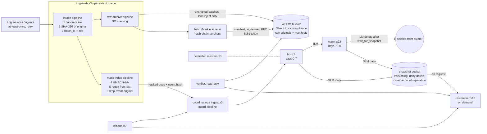

# Audit-Log Platform on the Elastic Stack: Architecture and Sizing Proposal

Status: proposal (architecture level, not a deployment runbook). Data classification: internal.
Every capacity figure below is copied from the output of the sizing model (`sizing.py`, base parameters listed in §2). None of the figures was benchmarked. Each estimate is labelled as one.

---

## 1. Executive summary

- **Volume.** 20,000 EPS × 800 B gives **16.00 MB/s**. That is **1.3824 TB/day** and **504.58 TB/year** of raw data.
- **Recommended option (P2).** Keep 30 days of interactive data on a Basic-licensed cluster: **7 hot + 23 warm data nodes**, 1 replica, about **82.94 TB** on disk. Everything else lives in a **12-month snapshot repository** of about **504.58 TB**. A request for data older than 30 days is answered by restoring the relevant days to a dedicated restore tier. The estimate is 0.77 h per day of data and 23.04 h for 30 days.
- **Customer suggestion rejected.** Searchable snapshots and the frozen tier require an **Enterprise** license, which the Basic-only budget rules out. P2 meets the underlying goal of saving storage without them. It needs 30 data nodes, against 112 for a Basic-only cold tier (P1).
- **Integrity.** Logstash computes SHA-256 over the original event **before** masking. Hashes are grouped into batches with a Merkle root and a hash chain. Batch manifests go to an Object-Lock (WORM) bucket and are anchored periodically with a signature or an RFC 3161 timestamp. The original events, which contain PII, are encrypted and kept in that WORM archive. Elasticsearch only holds the masked copy plus the hash. **Storing the originals still needs the customer's approval** (§13). A weaker fallback is defined for the case where they refuse.
- **Biggest risks.**
  1. The customer has not yet decided whether originals may be stored.
  2. The 1.0 index-to-raw ratio is assumed, not measured. At 1.5 the hot/warm tier grows to 44 nodes.
  3. Queries that span more than about 31 days of old data exceed the 24 h SLA. At half the assumed restore throughput, the limit is about 15.6 days.
  4. Basic has no Elasticsearch audit logging and no field/document-level security.

## 2. Assumptions

| ID | Assumption | Value | Status |
|---|---|---|---|
| A1 | Ingest is steady at 20,000 EPS with 800 B average raw event size, 24/7. No burst model; bursts are absorbed by A2 and the Logstash persistent queue. | `EPS = 20000`, `event_bytes = 800` | Customer input |
| A2 | Headroom for growth and shard imbalance, applied on top of the disk watermark | `growth_headroom = 0.2` | Assumption |
| A3 | Ratio of on-disk index size to raw size, with `best_compression` and including mapping, `_source` and doc-values overhead | base `index_to_raw_ratio = 1.0`; sensitivity 0.5 / 1.0 / 1.5 | **Assumption, not a measurement.** Must be calibrated in a PoC with real log samples |
| A4 | Snapshot size relative to primary data (incremental, no replicas) | `snapshot_ratio = 1.0` | Assumption, not measured |
| A5 / D1 | Disk per data node: hot 4 TB, warm 4 TB, cold/restore 8 TB. Usable fraction set by the disk watermark. | `disk_per_node_hot_TB = 4`, `disk_per_node_warm_TB = 4`, `disk_per_node_cold_TB = 8`, `disk_watermark = 0.85` | Design decision; adjust to the hardware actually procured |
| A6 | Restore throughput | `restore_throughput_MBps_per_node = 50` across `restore_nodes = 10` | **Estimate, not measured.** Requires raising `indices.recovery.max_bytes_per_sec` above its default |
| A7 | Target primary shard size | `target_shard_GB = 50` | Assumption |
| — | Replicas: hot/warm 1, cold 0 (P1 only). Interactive window 30 days, retention 365 days, SLA 24 h. Hot/warm split 7 + 23 days. | from sizing parameters | Customer input / design decision |

Hardware sizes (vCPU, RAM) in §5 come from experience. They are not benchmarks.

## 3. Capacity arithmetic

### 3.1 Formulas

```
throughput        = EPS × event_bytes                     = 20,000 × 800 B         = 16.00 MB/s (128.0 Mbit/s)
events/day        = EPS × 86,400                                                   = 1,728,000,000
raw/day           = throughput × 86,400 s                                          = 1.3824 TB  (1.2573 TiB)
raw/year          = raw/day × 365                                                  = 504.58 TB  (458.91 TiB)

primary(tier)     = raw/day × days_in_tier × index_to_raw_ratio
on_disk(tier)     = primary(tier) × (1 + replicas)
usable/node       = disk_per_node × disk_watermark
nodes(tier)       = ceil( on_disk(tier) × (1 + growth_headroom) / usable/node )
snapshot_repo     = raw/year × index_to_raw_ratio × snapshot_ratio
```

Compression assumption (A3): the index on disk is taken to be the same size as the raw input (ratio 1.0). This assumes `best_compression` roughly cancels out the overhead of the inverted index, doc values and `_source`. Field-heavy schemas can push the ratio above 1.0, and lean ones can bring it down to about 0.5. **Treat 1.0 as a planning value only.** The first PoC deliverable is a measured ratio taken from a few days of real, masked samples.

### 3.2 Storage per tier (base ratio 1.0)

| Tier | Days | Replicas | Primary | On disk incl. replicas | Usable/node | Nodes |
|---|---|---|---|---|---|---|
| Hot + warm (interactive) | 30 | 1 | 41.47 TB | **82.94 TB** | 3.40 TB | **30** |
| — split: hot | 7 | 1 | — | 19.35 TB | 3.40 TB | 7 |
| — split: warm | 23 | 1 | — | 63.59 TB | 3.40 TB | 23 |
| Cold (P1 only, days 31–365) | 335 | 0 | 463.10 TB | 463.10 TB | 6.80 TB | 82 |
| Snapshot repository (object storage) | 365 | n/a | — | **504.58 TB** | — | — |

Shards: the daily index is 1.382 TB of primary data, which gives **28 primary shards/day** at 50 GB each. The hot+warm tier holds 1,680 shards including replicas across 30 nodes, or **56.0 shards/node**.

Not covered by the model: the size of the **encrypted raw-original WORM archive** (§8). Its uncompressed upper bound is the raw volume, 504.58 TB per 12 months. The compressed size must be measured in the PoC. Manifests and anchors are negligible by comparison.

### 3.3 Sensitivity to the compression assumption (A3)

| Ratio | Hot+warm TB (with replicas) | Hot+warm nodes | P1 cold TB | P1 cold nodes | Snapshot TB | P2 total data nodes | P1 total data nodes |
|---|---|---|---|---|---|---|---|
| 0.5 | 41.47 | 15 | 231.55 | 41 | 252.29 | 15 | 56 |
| **1.0** | **82.94** | **30** | **463.10** | **82** | **504.58** | **30** | **112** |
| 1.5 | 124.42 | 44 | 694.66 | 123 | 756.86 | 44 | 167 |

### 3.4 Option comparison: P1 vs P2 (base ratio)

Both options use Basic features only. The searchable-snapshot option is excluded (§11, C1).

| | P1: cold tier, replica 0 | **P2: snapshot only (recommended)** |
|---|---|---|
| Data nodes, hot/warm | 30 | 30 |
| Data nodes, cold | 82 | 0 |
| Total data nodes | 112 | 30 |
| Cluster disk (TB, with replicas) | 546.05 | 82.94 |
| Snapshot repository (TB) | 504.58 | 504.58 |
| Total stored (TB) | 1050.62 | 587.52 |
| Interactive search > 30 days | yes | no (restore) |
| Copies of old data | ES + snapshot | snapshot only (+ raw WORM archive) |

**Decision: P2.** It needs 82 fewer data nodes and about 463 TB less cluster disk. The customer only asked for older data to be searchable *within 24 hours*, and restore meets that for windows up to about 31 days (§9). P1 does not avoid snapshots: its cold tier is a single unreplicated copy, so the snapshot repository is required either way. P1 only makes sense if the customer actually needs interactive search beyond 30 days (§13, Q1).

## 4. Overall architecture



Sensitive hops: source → Logstash and the `raw-archive` path carry **unmasked PII** and must use TLS, run on a restricted network segment and be accessible to few people. Everything that reaches Elasticsearch has already been masked. ES admin actions are logged by a reverse proxy in front of ES/Kibana and by object-storage access logs, all shipped outside the cluster (C5).

Kafka is not included by default. Add it (3 brokers, replication factor 3) only if one of these applies: the customer will not accept the loss of un-flushed Logstash PQ data when a Logstash host dies; hours to days of buffering are needed during a cluster outage; or other consumers such as a SIEM need the stream.

## 5. Node layout per tier (P2, hot/warm split)

| Role | Count | vCPU | RAM | Heap | Disk | Node roles / notes |
|---|---|---|---|---|---|---|
| Master (dedicated) | 3 | 4 | 16 GB | 8 GB | 100 GB SSD | `[master]`, spread over 3 zones/racks |
| Hot data | 7 | 16 | 64 GB | 30 GB (below compressed-oops limit) | 4 TB NVMe | `[data_hot, data_content]`. 28 primary + 28 replica shards/day ≈ 8 shards/node/day; 2,857 EPS/node (primaries) |
| Warm data | 23 | 8 | 64 GB | 30 GB | 4 TB SSD | `[data_warm]`, read-mostly, force-merged |
| Coordinating / ingest | 3 | 8 | 32 GB | 16 GB | 100 GB | `[ingest]` or coordinating-only; Kibana connects here |
| Restore tier (on demand) | 10 | 8 | 64 GB | 30 GB | 8 TB | `[data_cold]`, replica 0, 68.0 TB usable ≈ 49.2 days of data (A6) |
| Logstash | 3 | 8 | 16 GB | 8 GB | 500 GB SSD for PQ | about 8.6 h of buffer at full rate (S1 estimate, before compression) |
| Kibana | 2 | 4 | 8 GB | — | — | behind an authenticating reverse proxy |

Steady state comes to **36 Elasticsearch nodes** (3 + 7 + 23 + 3), plus 3 Logstash and 2 Kibana. The 10 restore nodes only run during investigations, but **they must be provisionable well inside the 24 h SLA**. If provisioning can take hours, keep them as warm standby (§11, R3).

Why split hot and warm: the node count is disk-bound either way (30 nodes). The split puts only 7 nodes on NVMe with high CPU, and the 23 warm nodes can use cheaper SSD and less CPU. The alternative of 30 hot nodes avoids the ILM migration I/O but pays for 30 high-CPU nodes to handle 16 MB/s (667 EPS/node), which is far more than needed.

## 6. Ingest pipeline

Order is mandatory: **canonicalise → hash → fork → mask → index.** The hash must be computed on the original, before any masking (§8).

| Step | Where | Action |
|---|---|---|
| 1 | Logstash `intake` | Keep the received bytes in `event.original`. For JSON sources, serialise canonically (sorted keys, UTF-8, no insignificant whitespace). |
| 2 | Logstash `intake` | `event.hash = SHA-256(event.original)` with the unkeyed `fingerprint` filter, and set `event.hash_algo = sha256`. |
| 3 | Logstash `intake` | Assign `ingest.batch_id` (instance id + time window) and a monotonic `ingest.seq` per instance. Getting a deterministic sequence may require a single worker on this step; validate throughput in the PoC (R6). |
| 4 | fork (pipeline-to-pipeline, persistent queues) | The same event goes to `raw-archive` and to `mask-index`. Without the fork, a single pipeline would need `clone` before masking or the original would be overwritten. |
| 5a | `raw-archive` | Write encrypted batch files to the WORM bucket using PutObject rights only. The sidecar builds the Merkle root, hash chain, manifest and anchor. |
| 5b | `mask-index` | HMAC-SHA256 pseudonymisation of the structured fields `user.name`, `user.email` and the phone field. Values are normalised first: e-mail lower-cased; digits only for phone numbers. |
| 6 | `mask-index` | Regex safety net on free text (`message`): e-mail; phone numbers with a `+` prefix or a `phone/tel/mobile` keyword; username after `user=`/`username:`/`login=`. Each match becomes `<prefix>_<first 16 hex chars of HMAC>`. Also set `pii.key_id`. |
| 7 | `mask-index` | `remove_field => ["[event][original]"]`. **Fail closed**: if the HMAC key is missing, the pipeline stops and nothing is written to ES. |
| 8 | ES ingest node, `audit-ingest` | Guard only: set `event.ingested`, drop any residual `event.original`, reject documents that have no `pii.key_id` (meaning they were never masked). |

Key handling: the HMAC key lives in KMS/Vault and reaches Logstash through the Logstash keystore or an environment variable (`${PII_HMAC_KEY}`). It never goes in the repository, pipeline files, logs or Elasticsearch. Key rotation is described in §8.4.

The regex rules were tested against 10 positive samples (all masked) and 10 negative samples (all left unchanged): order IDs, timestamps, 10-digit counters, UUIDs, IPs, plain words such as "user". The test covers the rules only, not a running Logstash. Known false negatives are listed in R5.

Guard pipeline (draft; not executed against a cluster):

```json
PUT _ingest/pipeline/audit-ingest
{
  "description": "Guard only. Hashing and masking are done in Logstash before this point.",
  "processors": [
    { "set":    { "field": "event.ingested", "value": "{{{_ingest.timestamp}}}" } },
    { "remove": { "field": ["event.original", "_tmp_raw"], "ignore_missing": true } },
    { "fail":   { "if": "ctx.pii?.key_id == null || ctx.event?.hash == null",
                  "message": "unmasked or unhashed document rejected" } }
  ]
}
```

There is deliberately **no `on_failure` handler that indexes the document elsewhere**. A rejected document returns an error to Logstash and goes to its dead-letter queue. That data is already masked, and its original is already in the WORM archive. Whether the Logstash ES output sends this kind of rejection to the DLQ must be confirmed in the PoC (Q8).

Index template (abridged draft):

```json
PUT _index_template/audit-logs
{
  "index_patterns": ["audit-logs"],
  "data_stream": {},
  "priority": 200,
  "template": {
    "settings": {
      "index.number_of_shards": 28,
      "index.number_of_replicas": 1,
      "index.codec": "best_compression",
      "index.lifecycle.name": "audit-ilm-p2",
      "index.default_pipeline": "audit-ingest",
      "index.refresh_interval": "30s"
    },
    "mappings": {
      "dynamic": "strict",
      "properties": {
        "@timestamp": { "type": "date" },
        "event":  { "properties": { "action": {"type": "keyword"}, "outcome": {"type": "keyword"},
                                    "ingested": {"type": "date"}, "hash": {"type": "keyword"},
                                    "hash_algo": {"type": "keyword"} } },
        "ingest": { "properties": { "batch_id": {"type": "keyword"}, "seq": {"type": "long"} } },
        "pii":    { "properties": { "key_id": {"type": "keyword"} } },
        "user":   { "properties": { "name": {"type": "keyword"}, "email": {"type": "keyword"}, "phone": {"type": "keyword"} } },
        "source": { "properties": { "ip": {"type": "ip"} } },
        "message": { "type": "text" }
      }
    }
  }
}
```

The field list is illustrative and the real schema depends on the customer's log sources. With `dynamic: strict`, unknown fields are rejected and land in the Logstash DLQ rather than being indexed unmasked. That is safer for PII, but adding a new source then requires a mapping change (accepted trade-off).

## 7. ILM and SLM

### 7.1 ILM, P2 (recommended)

```json
PUT _ilm/policy/audit-ilm-p2
{ "policy": { "phases": {
  "hot":    { "actions": { "rollover": { "max_age": "1d", "max_primary_shard_size": "50gb" },
                           "set_priority": { "priority": 100 } } },
  "warm":   { "min_age": "7d",
              "actions": { "forcemerge": { "max_num_segments": 1 },
                           "set_priority": { "priority": 50 } } },
  "delete": { "min_age": "30d",
              "actions": { "wait_for_snapshot": { "policy": "audit-daily" },
                           "delete": {} } }
} } }
```

- `min_age` counts from rollover, so a daily index stays searchable for about 30–31 days, which meets the 30-day requirement.
- `wait_for_snapshot` prevents deletion until the SLM policy has taken a snapshot that contains the index. A second precondition (§8.5) is that the WORM manifests for that day exist and verify. The sidecar checks this before the delete phase is allowed to proceed.
- On Basic, the warm phase migrates shards to `data_warm` nodes automatically through the data-tier preference.

For P1, the same policy would add `"cold": {"min_age": "30d", "actions": {"allocate": {"number_of_replicas": 0}}}` and move the delete phase to `365d`. It is not recommended.

### 7.2 SLM

```json
PUT _slm/policy/audit-daily
{
  "schedule": "0 30 1 * * ?",
  "name": "<audit-daily-{now/d}>",
  "repository": "audit-snap-repo",
  "config": { "indices": ["audit-logs"], "include_global_state": false },
  "retention": { "expire_after": "340d", "min_count": 30, "max_count": 500 }
}
```

How the retention value was derived: under P2, the snapshots that contain day D are taken between D+1 and about D+31. After that, ILM deletes the index and later snapshots no longer include it. Keeping day D available until D+365 therefore requires the **last** snapshot that contains it, taken around D+31, to survive until D+365. That snapshot has to live to an age of about 335 days, so `expire_after = 340d` gives 5 days of buffer.

The S1 draft used `400d`. That setting keeps data for about 430 days, which is longer than the 12-month retention and makes the right-to-erasure conflict (C8) worse. It is corrected here. If the customer treats 12 months as a minimum rather than a maximum, a longer value is acceptable (Q5).

- Snapshots are incremental, so the repository holds roughly 365 days of data (504.58 TB at base ratio), plus a few days because of the buffer.
- `max_count: 500` stays above the roughly 340 retained daily snapshots.
- SLM retention deletes snapshots automatically. A legal hold therefore means **cloning or copying the affected snapshot to a separate repository or prefix** that SLM does not manage, and placing an Object Lock legal hold on the matching raw WORM batches (Q6).

### 7.3 Snapshot repository

The repository is a dedicated bucket (`audit-snap-repo`). It is **not** under Object Lock compliance mode, because Elasticsearch rewrites and deletes repository metadata blobs (`index-N`, `index.latest`) and deletes blobs during SLM retention (C3). Protection measures:

- versioning enabled;
- a bucket policy that denies `DeleteObject*` and `PutBucketVersioning` to everyone except a two-person break-glass role;
- the cluster's access key limited to this bucket only;
- replication to a second account or region that the ES administrators cannot control.

Integrity of the snapshot contents rests on the hashes and manifests in the WORM bucket, not on this bucket (§8).

## 8. Integrity and chain of custody

### 8.1 Default design (requires customer approval to store originals, Q2)

1. **Per-event hash before masking.** `event.hash = SHA-256(canonical original)` is computed in Logstash (§6, steps 1–2). The masked ES document carries `event.hash`, `ingest.batch_id` and `ingest.seq`.
2. **Batch, Merkle tree and chain.** A batch is closed every 60 s or every 100,000 events; both parameters need tuning in the PoC. For each batch: `merkle_root` is computed over the `event.hash` values in `seq` order, then `batch_hash = SHA-256(prev_batch_hash ‖ merkle_root ‖ batch_id ‖ t_start ‖ t_end ‖ count)`. Deleting, altering or inserting a batch breaks the chain.
3. **Raw originals** are written as compressed, **encrypted** batch files (SSE-KMS at minimum; client-side envelope encryption if the customer requires it). They go to an **Object Lock compliance-mode** bucket with retention of 12 months plus a buffer. The exact period depends on the legal requirement (Q5). The archive uses its own KMS key.
4. **Manifest per batch** (batch_id, count, merkle_root, prev_batch_hash, batch_hash, file name and SHA-256 of the raw file, timestamps) is written to the same WORM bucket under a separate prefix.
5. **Anchoring** happens hourly or daily. The last `batch_hash` of the period is signed with a KMS/HSM key that cannot be exported, **or** stamped with an RFC 3161 timestamp from an external TSA. The token is stored next to the manifest. RFC 3161 is stronger because it does not depend on internal administrators (choice of TSA: Q3).

**Limitation:** this proves integrity **from the moment an event enters Logstash**. It does not cover the path from source to Logstash. Covering that path would require signing at the source agent, which is out of scope and listed as Q4.

### 8.2 Fallback if the customer refuses to store originals

Hash the **masked** event in a canonical form after masking: sorted keys, UTF-8, hash and ingest-metadata fields excluded. Use the same batch, Merkle, chain, anchor and manifest mechanism. The WORM bucket then holds manifests only, with no PII.

The fallback is **weaker**:

- it only proves that the *masked* copy has not changed since ingest;
- it cannot show that masking itself did not alter content with evidential value;
- it cannot answer the question "what did the original event say?";
- it cannot rebuild from source if the masking rules change.

The customer would need to accept this in writing. Possible middle grounds: encrypt and store only the PII fields of the original, or keep originals at the source system and store only the hashes here.

### 8.3 Separation of duties

| Role | Allowed | Not allowed |
|---|---|---|
| Logstash service account | PutObject to WORM raw and manifest prefixes; `create_doc` on the data stream | delete, retention changes, reading raw back, cluster admin |
| ES cluster (repository credentials) | read/write/delete in the snapshot bucket only | any access to the WORM bucket |
| ES administrator | cluster, ILM, SLM | IAM on either bucket; HMAC key; signing key |
| Storage/IAM administrator | bucket policies | ES superuser; KMS decrypt; signing key |
| Verifier (security/audit) | read WORM and run verification | write or delete |
| Break-glass | delete in the snapshot bucket, policy changes | day-to-day use; requires two people and is logged outside the cluster |

No single person holds write access to data together with delete or retention rights and signing rights.

### 8.4 Pseudonymisation key

HMAC-SHA256 is used instead of full redaction because investigators need to follow one user's actions and look up a known value by hashing it with the same key. Plain unkeyed SHA-256 is **not** acceptable for phone numbers or e-mail addresses, because the value space is small enough to brute-force.

- Each document carries `pii.key_id`.
- The key is rotated every 12 months or on suspected compromise. Old tokens are not re-hashed, so a lookup that spans a rotation must hash the value with every valid key.
- Old keys are kept for verification until retention ends.
- A leaked key means every token created with it must be treated as re-identifiable, which triggers a personal-data incident assessment.
- **Pseudonymised data is still personal data.** Elasticsearch must not be described as anonymised.

### 8.5 Verification and export

- **Event level.** Find the ES document's `batch_id`/`seq`. Decrypt the raw batch from WORM, recompute SHA-256 of `raw[seq]`, compare it with `event.hash`, check the Merkle inclusion proof against the manifest, and check the anchor. The masked document itself is checked by re-running masking on the raw event with the key identified by `key_id`.
- **Batch and day level.** Recompute the root and count, check that the `prev_batch_hash` chain is continuous and that no `seq` is missing, and compare event counts with ES. A scheduled job runs weekly over a random sample plus the whole chain, alerts outside ES, and writes its reports to WORM.
- **Before ILM delete** (P2): the day's manifests must exist and verify, and the snapshot must have completed.
- **Evidence export.** A request needs a case number, a requester, a legal basis and a time range. The approver must be a different person from the exporter. The export runs through the read-only verifier and produces a bundle: data, manifests, Merkle proofs, anchors, and the verifier tool version with its hash. The bundle itself is hashed and signed or timestamped, then recorded in a chain-of-custody log kept on WORM. Every hand-over adds an entry, and the receiver re-checks the bundle hash. Decrypting PII originals requires two approvers and is logged by KMS.
- The legal admissibility of this scheme must be confirmed by the customer's legal counsel. This document does not cite specific statutes.

## 9. Searching data older than 30 days (restore on request)

1. **Request and approval.** The requester submits a case ID, a time window and a justification, and someone else approves. This time counts against the 24 h SLA.
2. **Provision the restore tier.** Start 10 `data_cold` nodes if they are not on warm standby. Temporarily raise `indices.recovery.max_bytes_per_sec`.
3. **Pick snapshots.** For each requested day, the newest snapshot that still contains that day's backing index (`GET _snapshot/audit-snap-repo/_all`).
4. **Restore** into a separate namespace so the live data stream is untouched:

```json
POST _snapshot/audit-snap-repo/<audit-daily-YYYY.MM.DD>/_restore
{
  "indices": ".ds-audit-logs-YYYY.MM.DD-*",
  "rename_pattern": "\\.ds-(.+)",
  "rename_replacement": "restored-$1",
  "include_global_state": false,
  "index_settings": {
    "index.number_of_replicas": 0,
    "index.routing.allocation.include._tier_preference": "data_cold",
    "index.blocks.write": true
  },
  "ignore_index_settings": ["index.lifecycle.name", "index.default_pipeline"]
}
```

5. **Verify.** Run the batch-level check (§8.5) on the restored indices against the WORM manifests before results are used as evidence.
6. **Search** in Kibana through a `restored-*` data view, restricted by RBAC to the investigation role.
7. **Clean up.** Delete the restored indices and stop the restore nodes when the case closes. The snapshot remains the copy of record.

**Estimated restore time.** This is an estimate from A6 (10 nodes × 50 MB/s = 500 MB/s), not a measurement:

| Window | Size | Estimated time | Within 24 h |
|---|---|---|---|
| 1 day | 1.38 TB | 0.77 h | yes |
| 30 days | 41.47 TB | 23.04 h | yes (close to the limit) |

Window limited by time: 31.2 days. Window limited by capacity: 49.2 days (68.0 TB). Effective window: **about 31 days per 24 h**.

| Throughput per node | 1 day | 30 days | Days restorable within SLA |
|---|---|---|---|
| 25 MB/s | 1.54 h | 46.08 h | 15.6 |
| 50 MB/s | 0.77 h | 23.04 h | 31.2 |
| 100 MB/s | 0.38 h | 11.52 h | 62.5 |

These figures exclude approval time, repository listing, shard-allocation delays, query time and contention with ingest. Wider windows need more restore nodes or several batches (R2).

If snapshots are lost or corrupted, the data can still be rebuilt from the raw WORM archive by replaying it through the `mask-index` pipeline. This is slow and is not covered by the SLA.

## 10. Licensing (Basic only)

"Confirmed" means the source was actually read during this work. Every other row is **based on knowledge, not verified online** and must be checked against https://www.elastic.co/subscriptions and the Elastic 8.x documentation for the version being deployed (Q9).

| Feature | Minimum license | Source / status |
|---|---|---|
| Searchable snapshots (and the frozen tier, which is built on them) | **Enterprise** | **Confirmed:** https://www.elastic.co/docs/deploy-manage/tools/snapshot-and-restore/searchable-snapshots ("requires an Enterprise license"). The page states no separate license for frozen, but frozen depends on searchable snapshots. |
| Snapshot/restore to S3/FS repository, SLM | Basic | not verified online |
| ILM (rollover, forcemerge, allocate, delete, `wait_for_snapshot`), data tiers with regular indices | Basic | not verified online |
| Data streams, index templates, ingest pipelines (`set`, `remove`, `fail`), `best_compression` | Basic | not verified online |
| TLS, native RBAC, API keys | Basic | not verified online |
| Logstash (`fingerprint`, `mutate`, `ruby`, `s3`, `elasticsearch`, persistent queue, DLQ) | free / Basic | not verified online |
| Field- and document-level security | above Basic | not verified online → compensating control C4 |
| Elasticsearch audit logging | above Basic | not verified online → compensating control C5 |
| Most Kibana alerting connectors (e-mail, Slack, PagerDuty, webhook) | above Basic (index / server-log connectors on Basic) | not verified online → compensating control C6 |
| Synthetic `_source` | Enterprise (8.17+) | seen on elastic.co/subscriptions; not used |
| Kibana sub-feature privileges | Gold+ | seen on elastic.co/subscriptions; not used |
| S3 Object Lock on a snapshot repository | not a license feature | **No official documentation found.** A community thread (https://discuss.elastic.co/t/searchable-snapshot-s3-object-lock/349418) says it interferes with snapshots. Not used as a basis → C3 |
| Kafka (optional) | Apache 2.0, not Elastic | — |

## 11. Risks and conflicts in the inputs

### 11.1 Conflicts

| ID | Conflict | Severity | Resolution in this design |
|---|---|---|---|
| C1 | **Customer suggestion "searchable snapshots for cold/frozen"** conflicts with the Basic-only constraint, because searchable snapshots and frozen require Enterprise. | blocker for the suggestion | **Rejected.** P2 (regular snapshots plus restore on request) achieves the storage saving on Basic: 587.52 TB total and 30 data nodes, against 1050.62 TB and 112 nodes for P1. |
| C2 | "Mask before indexing" conflicts with "provably unaltered". Once the data is masked, ES no longer holds the original. | blocker (pending decision) | Default: hash the original before masking and keep it encrypted in WORM (§8.1). Fallback: hash the masked event (§8.2), which is weaker. Q2. |
| C3 | WORM (Object Lock compliance) conflicts with the snapshot repository, which rewrites and deletes metadata blobs and deletes blobs under SLM retention. | major | WORM is used for raw data and manifests only. The snapshot bucket uses versioning, delete denial, duty separation and replication (§7.3). Needs a PoC; no official source either way. |
| C4 | Basic has no field- or document-level security. | major | PII is masked before indexing, so ES holds no clear-text PII. Separate indices by sensitivity if needed, apply RBAC per index pattern, and put a proxy in front of Kibana/ES. |
| C5 | An *audit* platform without Elasticsearch audit logging: who searched or changed what is not recorded by ES. | major | Reverse-proxy access logs in front of ES/Kibana, object-storage access logs and OS logs, all shipped off-cluster to WORM. Alternatively, upgrade the license (Q7). |
| C6 | Basic alerting connectors are limited. | minor | Health checks for ILM/SLM failures, broken hash chains and post-ingest PII scans run as scripts in the customer's existing monitoring (Prometheus/Alertmanager or similar). Not designed further here. |
| C7 | ILM delete conflicts with keeping evidence for 12 months. | major | `wait_for_snapshot` plus a verified WORM manifest are both required before delete (§7.1). Legal hold works by copying snapshots out of SLM and placing an Object Lock legal hold on raw data (Q6). |
| C8 | The right to erasure of personal data conflicts with immutable WORM storage. | major | Retention is set to 12 months plus a short buffer only, and the SLM value is corrected from 400d to 340d. Erasure can be done by crypto-shredding the per-period raw-archive key. Legal counsel must confirm this. |
| C9 | "Searchable within 24 h" for 12 months conflicts with the restore throughput limit. | major | About 31 days of data can be restored per 24 h under A6, but only about 15.6 days at 25 MB/s/node. See R2 and Q1. |
| C10 | Encryption at rest is not an Elasticsearch feature on Basic. | minor | TLS on all hops (Basic). Disk and volume encryption from the infrastructure. KMS encryption of the raw archive. |

### 11.2 Technical risks

| ID | Risk | Mitigation |
|---|---|---|
| R1 | Index-to-raw ratio (A3) is unmeasured. At 1.5, hot+warm needs 44 nodes (124.42 TB) and the snapshot repository 756.86 TB. | Measure in the PoC before ordering hardware, and use the sensitivity table (§3.3) for budget ranges. |
| R2 | Restore SLA. A wide investigation window (more than about 15–31 days, depending on real throughput) or several concurrent requests will exceed 24 h. | Measure restore throughput in the PoC. Restore the narrowest window first. Add restore nodes or run batches. Agree the SLA scope with the customer (Q1). |
| R3 | Restore nodes are provisioned on demand. If provisioning takes hours, the SLA budget shrinks. | Keep the 10 nodes as warm standby, or pre-approve automated provisioning. |
| R4 | P2 holds data older than 30 days only in snapshots (plus the raw archive). Repository corruption or deletion would be serious. | Versioned bucket with delete denial and cross-account replication. Scheduled test restores. Raw-archive replay as last resort. |
| R5 | Masking false negatives allow PII into the index: bare phone numbers without `+` or a keyword, usernames not preceded by `user=`, obfuscated e-mails (`%40`, "at"), personal names, unknown fields. False positives (`user=root`, `git@host`) reduce readability. | Mask by **structured field** first, with regex only as a safety net. `dynamic: strict` mapping. Scheduled post-ingest scans for e-mail and long-digit patterns. Measure rates on real samples in the PoC. Allow-list for system accounts. |
| R6 | Assigning a deterministic `seq` and running batch/Merkle processing may bottleneck Logstash (about 6.7k EPS per instance across 3). No standard plugin exists for Merkle or anchoring. | PoC throughput. Small sidecar service (build or buy: Q10). |
| R7 | The Logstash persistent queue is not replicated, so losing a host loses events not yet flushed. | Sources must use at-least-once delivery with acknowledgements. Add Kafka if that is not acceptable. |
| R8 | No ES audit log (C5) means a privileged ES administrator could alter indexed documents without ES recording it. | ES is not the evidence of record. The WORM hashes detect any alteration (§8.5). Duty separation (§8.3). |
| R9 | The JSON in this document has not been run against a cluster. | Validate all JSON in the PoC on the target 8.x version. |

## 12. Not in scope

- Deployment runbooks.
- Designs for features that require licenses above Basic.
- Kafka, unless triggered by R7.
- Source-side signing (Q4).
- Hardware procurement beyond the sizing above.

## 13. Open questions for the customer

| # | Question |
|---|---|
| Q1 | Is search beyond 30 days acceptable through restore within 24 h (P2)? What is the typical window and frequency of investigations? Interactive search beyond 30 days would require P1 (+82 nodes) or a license upgrade. |
| Q2 | **May the original events containing PII be stored, encrypted in WORM and with separated duties?** Who may decrypt them, and under what approval? If not, will you accept in writing the weaker masked-hash fallback (§8.2) or one of the middle grounds? |
| Q3 | Should anchoring use an internal KMS/HSM signature or an external RFC 3161 TSA? If a TSA, which one? |
| Q4 | Must integrity be provable from the source system rather than from ingest? That would require signing at the agent. |
| Q5 | Is 12 months a minimum, a maximum, or exact? What is the exact WORM retention period your legal counsel requires? |
| Q6 | Are legal holds beyond 12 months needed, and what is the process for them? |
| Q7 | Must end-user searches of the audit data themselves be logged? Is a license upgrade possible for ES audit logging or FLS/DLS? |
| Q8 | Which object storage will be used (AWS S3, S3-compatible on-prem such as MinIO, other)? Does it support Object Lock compliance mode, versioning and cross-account replication? Can it host a PoC of the snapshot-repository behaviour (C3) and of DLQ handling for rejected documents? |
| Q9 | Please confirm the Elastic version (8.x) to be deployed, so every license row marked "not verified online" can be checked against the subscriptions page for that version. |
| Q10 | For the batch, Merkle and anchoring service: build a small sidecar, or use an existing product? |
| Q11 | Which monitoring, ticketing and alerting systems already exist, to use for C6? |
| Q12 | Can real log samples be provided under an approved process, so the PoC can calibrate A3 and the masking false-negative rate? |
