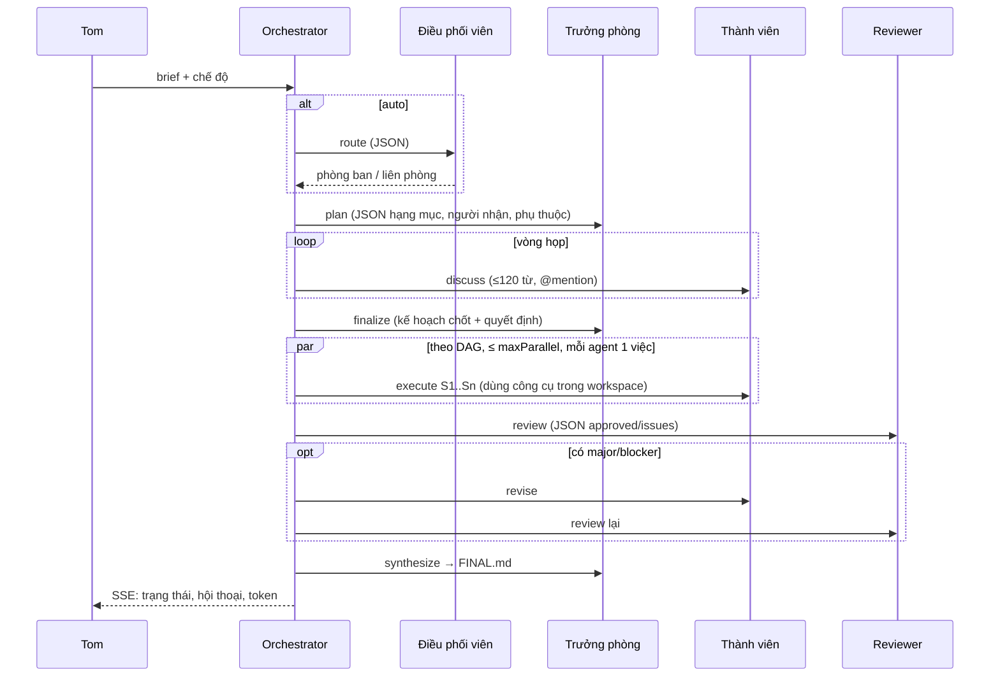

# Kiến trúc CCoding Office

## Thành phần

| Thành phần | File | Vai trò |
|---|---|---|
| CLI | `src/cli.ts` | `serve`, `task`, `status`, `show`, `logs`, `usage`, `agents`, `project`, `doctor`, `herdr`, `agent-exec` |
| Server | `src/server.ts` | REST + Server-Sent Events, phục vụ giao diện `public/`; chỉ nghe 127.0.0.1, chống CSRF/DNS-rebinding |
| Orchestrator | `src/orchestrator.ts` | Hàng đợi nhiệm vụ, định tuyến, vòng đời phòng ban, khóa theo agent, ngân sách token, hủy |
| Prompt | `src/prompts.ts` | Ghép hồ sơ vị trí (agent.md) + bối cảnh + yêu cầu từng pha |
| Planner | `src/planner.ts` | Đọc JSON kế hoạch/review/định tuyến của LLM, sửa lỗi phổ biến, DAG phụ thuộc, lập lịch |
| Registry | `src/registry.ts` | Nạp `agents/**/*.md`, `departments/*.md` |
| Runtimes | `src/runtimes/*` | `claude-cli`, `codex-cli`, `kimi-cli`, `anthropic-api`, `openai-api`, `mock` |
| Log | `src/logger.ts` | JSONL append-only, chuỗi băm, che PII/bí mật |
| Token | `src/usage.ts` | Sổ cái `usage/ledger.jsonl` + tổng hợp |
| Store | `src/store.ts` | `runs/<task>/task.json`, transcript, dự án |
| herdr | `src/herdr.ts` | Dựng workspace, pane theo agent, báo trạng thái/token |

## Vòng đời một nhiệm vụ

- **Liên phòng**: Phòng Nghiên cứu chạy đủ vòng đời trước; báo cáo của phòng này trở thành "kết quả từ phòng trước" trong prompt của Phòng Phát triển.
- **Theo dự án**: dự án quy định phòng mặc định (`auto`/`dev`/`research`/`joint`), workspace, runtime, phân loại dữ liệu, danh sách agent tham gia, model riêng từng agent và ngân sách token.

## Trạng thái agent

`idle` (rảnh) · `thinking` (lập kế hoạch/chốt/tổng hợp/định tuyến) · `discussing` (đang họp — nhân vật đi vào phòng họp) · `working` (thực thi/sửa) · `reviewing` · `error`.

Mỗi agent chỉ chạy **một lượt tại một thời điểm** (khóa theo agent) — hai nhiệm vụ cùng cần một người thì người đó làm lần lượt.

## Sự kiện thời gian thực (SSE `/api/events`)

| event | dữ liệu |
|---|---|
| `agent` | trạng thái agent (status, activity, task, runtime) |
| `task` | ảnh chụp nhiệm vụ |
| `message` | tin nhắn hội thoại (plan, discussion, decision, handoff, review, final, system) |
| `usage` | một bản ghi sổ cái token |
| `log` | một dòng log |
| `output` | đoạn văn bản agent đang stream |

## REST API

| Method | Đường dẫn | Mô tả |
|---|---|---|
| GET | `/api/state` | toàn cảnh: phòng ban, agent, nhiệm vụ, dự án, token |
| POST | `/api/tasks` | `{ brief, title?, mode, department?, projectId?, options? }` |
| GET | `/api/tasks/:id` | nhiệm vụ + transcript + danh sách file + token theo agent |
| GET | `/api/tasks/:id/file?path=FINAL.md` | nội dung file trong thư mục chạy |
| POST | `/api/tasks/:id/cancel` | hủy |
| GET | `/api/agents/:id` | agent.md, trạng thái, token, log vị trí |
| GET | `/api/usage?by=agent\|department\|task\|project\|model\|runtime\|day\|phase` | bảng token (lọc `agent`, `department`, `task`, `project`, `since`) |
| GET | `/api/logs?agent=&department=&task=&level=&limit=` | log |
| GET/POST/DELETE | `/api/projects` | dự án |
| GET | `/api/runtimes?refresh=1` | runtime khả dụng & được phép theo nhãn dữ liệu |
| POST | `/api/reload` | nạp lại agent.md/phòng ban |

Nếu đặt biến môi trường `CCODING_TOKEN`, mọi `/api/*` cần `Authorization: Bearer <token>` (hoặc `?token=` cho SSE); mở UI bằng `http://127.0.0.1:7420/#token=<token>`.

## Dữ liệu trên đĩa

Xem README › *Log & bộ đếm token*. Tất cả nằm trong `data/` (đã `.gitignore`), agent làm việc trong `workspaces/<dự án | task>` hoặc thư mục dự án chỉ định.
