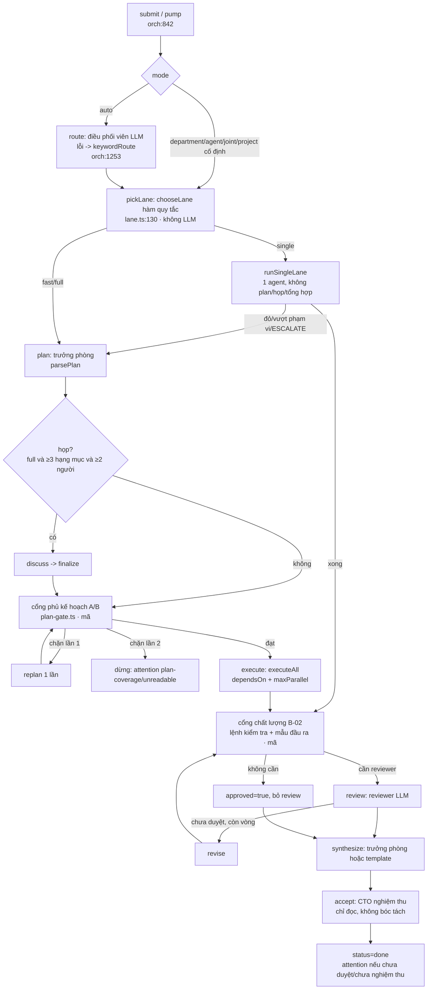
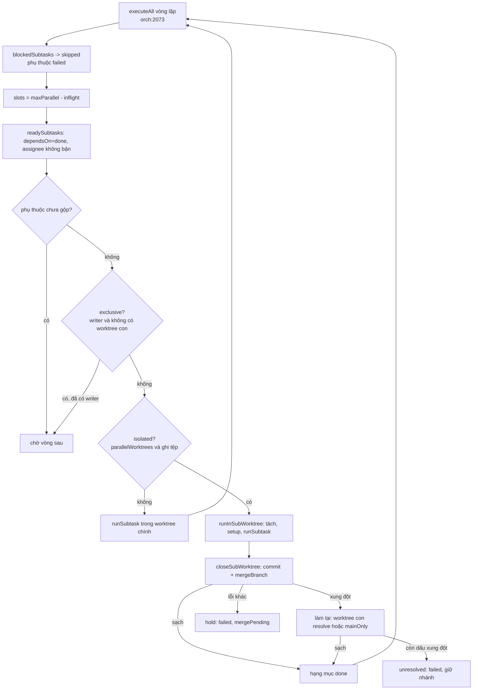

# Bản đồ engine và logic từng agent (K1, BRIEF-22)

> **Commit gốc: `b146b87c`.** Mọi `tệp:dòng` dưới đây đúng tại commit này; mã đổi thì số dòng lệch (kiểm tự động tệp:dòng ngoài phạm vi gói này, ghi thành mục backlog ở K6).
> Phân loại dữ liệu: **Nội bộ**. Chỉ đọc mã và hồ sơ; không có số vận hành thật. Điều chưa xác minh ghi **[CHƯA KIỂM CHỨNG]**.
> Đường dẫn rút gọn: `orch` = `src/orchestrator.ts`.

## 1. Engine

### 1.1 Vòng đời nhiệm vụ và các pha

Hàng đợi: `pump()` (`orch:842`) chạy tối đa `config.maxConcurrentTasks` nhiệm vụ cùng lúc, nhiệm vụ có `after` chờ nhiệm vụ trước xong (`waitingOn`, `orch:876`). `runTask` (`orch:1042`) là vòng đời một nhiệm vụ.

| Pha | Ai/cái gì quyết | Gọi LLM? | Vị trí |
|---|---|---|---|
| route | điều phối viên (`registry.router()`); lỗi hoặc làn đơn ép → `keywordRoute` | có (trừ làn đơn ép) | `orch:1253-1279`, gọi từ `orch:1052-1063` |
| chọn làn | hàm quy tắc `chooseLane` | **không** | `orch:1379` → `src/lane.ts:130` |
| plan | trưởng phòng (`lead`), `parsePlan` | có | `orch:1700-1717` |
| (làn nhanh) chỉnh kế hoạch | `shapeFastPlan` — mã | không | `orch:1318-1377` |
| discuss + finalize | thành viên + trưởng phòng; bỏ khi làn nhanh, hoặc < `meetingMinSubtasks` (mặc định 3) hạng mục, hoặc < 2 người | có | `orch:1719-1790` |
| cổng phủ kế hoạch | `planGate` — mã | không (có thể gọi lại plan 1 lần) | `orch:1803`, `orch:2403-2460`, `src/plan-gate.ts:158` |
| duyệt kế hoạch (tùy chọn) | giám đốc | không | `orch:1770-1778`, `orch:2462` |
| execute | thành viên; lập lịch bằng mã | có | `orch:1822-1832`, `orch:2073` |
| review/revise | cổng chất lượng (mã) rồi reviewer (LLM) nếu cần | có điều kiện | `orch:1836-2008` |
| synthesize | trưởng phòng; làn nhanh `finalReport: template` dựng bằng mã | có / không | `orch:2036-2065` |
| accept | CTO (`agents/cto.md`) | có (trừ chế độ skip) | `orch:1151-1237` |

Sau mọi phòng: `finishWorkspace` → `writeFinal` (`orch:1076-1078`). Còn hạng mục `failed/skipped` thì nhiệm vụ `failed` và **không** nghiệm thu (`orch:1081-1086`); ngược lại gọi `accept` rồi `status = 'done'` (`orch:1090-1094`).

Làn đơn (`single`) bỏ route/plan/họp/worktree con/tổng hợp: `runSingleLane` (`orch:1424-…`), có thể nâng làn khi còn đỏ sau `gate.maxFixRounds`, phạm vi vượt ngưỡng hoặc đầu ra có dòng `ESCALATE:` (chú thích `orch:1424-1429`).

### 1.2 Lập lịch, worktree con, gộp

- **Lập lịch** — `executeAll` (`orch:2073-2154`): vòng `for(;;)`; mỗi vòng đánh dấu hạng mục bị chặn là `skipped` (`blockedSubtasks`, `orch:2112`), tính `slots = task.options.maxParallel - inflight.size` (`orch:2116`), lấy hạng mục sẵn sàng qua `readySubtasks(run.subtasks, busy)` (`orch:2118`: `dependsOn` đã `done` và người nhận không bận — `busy` theo `assignee`, `orch:2133`). Hạng mục phụ thuộc hạng mục chưa gộp xong thì chờ (`orch:2119`).
- **Người ghi tuần tự, người đọc song song**: `writer(st)` = có `serialWriters` và người nhận chạy lệnh (`orch:2086`); `exclusive(st)` = writer mà không có worktree con, hoặc `mainOnly` (`orch:2094`). Khi không tách được worktree con, hạng mục chạy lệnh làm **lần lượt** và thông báo "🔒" (`orch:2120-2125`). Nghĩa là `maxParallel` chỉ có tác dụng đầy đủ khi `parallelWorktrees` bật.
- **Điều kiện tách worktree con** — `parallelWorktrees` (`orch:2683-2687`): `exclusiveWrites` đúng, cấu hình không tắt, có `task.branch` và `task.workspace`, `isolation` mặc định `worktree`.
- **Hạng mục trong worktree con** — `runInSubWorktree` (`orch:2707-2746`): khóa `withWtLock` (`orch:2689-2705`) khi tách/gộp → `openSubWorktree` (`orch:2816`) → `runSubSetup` (cài phụ thuộc, `orch:2880`) → `runSubtask` (`orch:2162`) → `closeSubWorktree` (`orch:2902`, luôn chạy trong `finally`).
- **Gộp** — `closeSubWorktree` (`orch:2902-3056`): commit worktree con (`commitAll`), `mergeBranch` vào nhánh nhiệm vụ; lỗi không do xung đột → commit lại thử 1 lần, vẫn lỗi → `hold` (hạng mục chuyển `failed`, `mergePending`, giữ worktree, `orch:2908-2919`).
- **Xung đột** — sau gộp xung đột, hạng mục được làm lại theo hai đường: worktree con giải quyết (`wt.resolve`, `st.conflict`) hoặc `mainOnly` trong worktree chính (`runInMainWorktree`, `orch:2748-2760`; `settleMainMerge`, `orch:2762`). Còn dấu xung đột → `unresolved` hủy merge, hạng mục **không** coi là xong (`orch:2920-2942`, `orch:2956-2971`). Dấu xung đột kiểm bằng `hasConflictMarkers` (`orch:4107`).
- **Dừng giữa chừng** — `stop` giữ lỗi đầu tiên; với `PauseSignal` hoặc có worktree con thì chờ hạng mục đang chạy dừng để gộp/gỡ, không bỏ agent mồ côi (`orch:2146-2151`).

### 1.3 Lệnh kiểm tra của dự án

`runProjectChecks` (`orch:3322`) do CCoding tự chạy (không qua agent): `denyCommands` (cấu hình + dự án), `commandTimeoutSec`, `maxOutputChars` (`orch:3325`). Ba mốc: `baseline` (trước khi sửa; chạy song song với plan/họp nếu `tools.earlyBaseline !== false`, `orch:1685-1700`), `execute` (sau executeAll, `orch:1826-1829`), `revise` (sau mỗi vòng sửa, `orch:2000`). Điều kiện chạy: `projectCheckable` (`orch:3196`). Hồi quy = đạt ở baseline, hỏng sau: `checkRegressions` (`orch:3392`).

### 1.4 Các cổng không dùng LLM

| Cổng | Hàm | Vào | Quyết định | Vị trí |
|---|---|---|---|---|
| Chọn làn | `chooseLane` | `LaneSignals`: briefChars, parts, filesTouched, repoFiles, repoBytes, sequential, serialWriters | quy tắc 1 (ép) → 2 (đề dài/repo lớn → full) → 3 (≥ `maxParts`=5 phần hoặc ≥ `maxFilesTouched`=6 tệp → fast; nối tiếp hoặc ghi tuần tự → single) → 4 (nhỏ → single) | `lane.ts:130-148`; tín hiệu `lane.ts:99-107`; ngưỡng mặc định `lane.ts:131` |
| Phủ kế hoạch | `planGate` | brief, planSummary, subtasks, outOfScope, repoFiles | A: mọi tệp **nguồn** nêu trong đề phải có hạng mục nhận hoặc khai ngoài phạm vi có lý do; B: số hạng mục khớp tự khai, deliverable có thật, vai trong mô tả khớp assignee, JSON không cụt | `plan-gate.ts:158-178`; A `:136`; B `:147`; đích chỉ tính `SOURCE_EXT` (`plan-gate.ts:42`) |
| Chất lượng B-02 | `runQualityGate` + `classifyChecks` + `templateGate` + `reviewerReasons` | kết quả lệnh baseline/latest, brief, đầu ra, đường dẫn đổi | vòng sửa theo kiểm tra ≤ `gate.maxFixRounds` (mặc định 2, cho cả nhiệm vụ); kiểm mẫu đầu ra; kết luận có cần reviewer | `orch:3205-3320`; `quality-gate.ts:33-135` |
| Mẫu đầu ra | `templateGate` | đầu ra + `body` hồ sơ agent | mọi tiêu đề của "Mẫu đầu ra" phải có nội dung + có `## Tóm tắt` | `quality-gate.ts:62-71` |
| Chọn chế độ nghiệm thu | `acceptMode` | làn, cấu hình slim | `skip` chỉ khi làn đơn chưa nâng, mọi lệnh xanh, diff không chạm vùng nhạy cảm, nhãn < Bảo mật; thiếu → `brief` | `orch:1239-1251` |
| Bộ kiểm lệnh (hook) | `claude-guard` + `shell-policy` + `guard-paths` | lệnh/đường dẫn của lượt công cụ | chặn lệnh theo chính sách; nhắc ghi tệp sau 16 lượt đọc, chặn sau 32 | `src/tools/claude-guard.ts`, `src/tools/shell-policy.ts`, `src/tools/guard-paths.ts` — chi tiết xem §1.5 |

Cổng phủ kế hoạch chặn → `replan` đúng 1 lần (`orch:2425-2441`, cờ `planGate.replanned`), vẫn trượt → ném lỗi và `attention` (`orch:2447-2459`): không chạy tập con.

### 1.5 Ngân sách, ước lượng, tạm dừng, runtime

- **Ngân sách**: `checkBudget` (`orch:2247`; chạm trần ở chế độ `pause` → `PauseSignal('budget')`, `orch:2266`), `checkSubtaskBudget` (`orch:2305`), `checkEstimate` (`orch:2630`). Mặc định `budgetTokens` 1.500.000, `maxParallel` 3, `maxRevisions` 1, `discussionRounds` 1 (`src/config.ts:374`).
- **Ước lượng**: `estimatePlan` (`orch:2356-2383`) = `estimate.base` + (review: `perReview × (1+maxRevisions)`) + tổng theo hạng mục (trung vị token thực tế gần nhất của agent nếu ≥ `minSamples`, ngược lại hằng số theo mức quyền công cụ; `src/estimate.ts:15-42`). **Ước lượng chỉ cộng token; không mô hình hóa thời gian hay lợi ích song song.**
- **Chọn model mỗi lượt** (`orch:3462`): `task.options.phaseModels[phase]` → `project.models[agent.id]` → `config.phases.models[phase]` → `agent.model`. Mặc định `phases.models = {route: haiku, discuss: haiku, synthesize: sonnet}` (`config.ts:377`); làn nhanh đặt `phaseModels.plan = fastLane.planModel` (mặc định sonnet, `config.ts:405`) khi chưa có (`orch:1650`). Hệ quả: **hồ sơ ghi `dev-lead`/`research-lead` là opus nhưng ở làn nhanh pha plan chạy sonnet.**
- **Runtime và chuyển runtime**: ứng viên từ `[task.options.runtime, project.runtime, agent.runtime, config.runtime.default]` lọc theo nhãn dữ liệu (`orch:3463-3470`, `runtimes.candidates`); `maxFailover` = 6 (`config.ts:365`); lỗi thuộc `CAPACITY_KINDS` (`orch:125`) thì chuyển ứng viên (`orch:3664-3669`). Runtime hiện có: `claude-cli` (`runtimes/claude-cli.ts:312`), `anthropic-api` (`api.ts:22`), `openai-api` (`api.ts:217`), `codex-cli`, `kimi-cli` (`cli-agents.ts:64,158`), `external.ts`, `mock`.
- **Tạm dừng và tiếp tục**: mọi lượt gọi đi qua `Orchestrator.call()` (`orch:3436`). Tất cả ứng viên lỗi do hạn mức/kết nối → `PauseSignal('quota', …, resumeAt)` (`orch:3686-3690`; 2 phút nếu chỉ lỗi mạng, ngược lại `runtimes.earliestRecovery()` hoặc `quotaCooldownMs`). Giờ mở lại lấy từ thông báo lỗi bằng `parseRetryAt` (`runtimes/errors.ts:112`; ví dụ "resets 1am (Asia/Bangkok)" ở `orch:3603`) — đây là chỗ BRIEF-D16 nối hạn mức 5 giờ. `runTask` bắt `PauseSignal`: `status='paused'`, hạng mục đang chạy về `pending`, ghi `pause.resumeAt` và `scheduleResume` (`orch:1097-1136`, `orch:1016`). "Không còn runtime" lặp lại giãn 5/10/20/40/60 phút rồi dừng hẳn (`orch:1103-1113`). Chờ model nhanh mở lại tối đa `waitForFastMs` = 30 phút (`config.ts:368`, `orch:3487-3493`). Trạng thái dở dang của hạng mục giữ ở `st.handover` (`orch:3448-3452`). Kiểm thử đi kèm: `test/quota-5h-pause.test.ts` (đã có trong merge D16, `git show 7b196e31 --stat`).
- **Cắt cụt và chạm trần lượt**: `claude-cli` đặt `--max-turns` theo `phases.toolTurns` (`claude-cli.ts:271-272`) và trả `capped: 'turns'` **không kèm `error`** (`claude-cli.ts:238,389`). Chỉ `runSubtask` xử lý `capped` bằng "chạy tiếp" ≤ `maxContinuations`=2 (`orch:2188-2210`, `config.ts:381`); `continueTruncated` chỉ cho pha execute/revise/synthesize (`orch:124`). Các pha khác không có đường chạy tiếp (xem §4, mục L4).

### 1.6 LogStore và chuỗi băm

`LogStore` (`src/logger.ts`) ghi JSONL append-only; khi `hashChain` bật, mỗi dòng có `seq`, `prev` và `hash` = 32 ký tự đầu của sha256(`prev` + thân bản ghi) (`logger.ts:66-72`), đầu chuỗi `genesis` (`logger.ts:84`), có bộ kiểm chuỗi `chainChecker` (`logger.ts:122`). Che PII/bí mật theo `opts.redactSecrets`/`redactPii` (`logger.ts:24`). Mọi cổng ghi `gate.decision` qua LogStore (`orch:1224` CTO, `orch:2411` phủ kế hoạch, `orch:3317` chất lượng B-02). Chuỗi băm phát hiện sửa, **không** ký số và không WORM — [CHƯA KIỂM CHỨNG] ở cấp lưu trữ.

### 1.7 Cấu hình mặc định liên quan chia việc

`fastLane`: `enabled`, `maxBriefChars` 4000, `maxRepoFiles` 300, `maxRepoBytes` 1,5 MB, `maxParallel` 4, `finalReport: 'template'` (`config.ts:405`). `lanes.single`: `maxParts` 5, `maxFilesTouched` 6 (`lane.ts:131`). `gate.maxFixRounds` 2 (`config.ts:372`). `phases.meetingMinSubtasks` 3 (`orch:1733`).

## 2. Bảng từng agent

Cấu hình phòng: `departments/dev.md` (lead `dev-lead`, reviewer `qa-tester`), `departments/research.md` (lead `research-lead`, reviewer `peer-reviewer`). **Phòng Dev chỉ có một reviewer là `qa-tester`**; `security` là thành viên thường (`role: member`). Tệp hồ sơ: `agents/<tên>.md`, frontmatter dòng 1–12.

Cột **Model BM** (bench): lấy từ `byPhaseModel` trong `bench/vs-claude/results/gates-main/runs.jsonl` (đếm trên 195 dòng có trường này: route haiku + plan/execute/accept sonnet: 64; plan/execute sonnet + accept **opus**: 58; plan/execute/accept sonnet: 53) và `bench/vs-claude/arms.json` (B3 toàn Opus, B7cabO `accept: opus`). Bench không ghi model theo agent mà theo pha; pha `review` hầu như không xuất hiện trong các tổ hợp trên [CHƯA KIỂM CHỨNG cho toàn bộ 8 tệp runs.jsonl]. Cột **KPI** = có trong `kpi-office.json` (14 agent).

Quy ước công cụ: tên trong hồ sơ ánh xạ qua `AGENT_TOOL_MAP` (`src/tools/workspace.ts:34`; `Bash` → `run_command`), rồi bị cắt theo pha ở `toolsFor` (`workspace.ts:51-63`): `route`/`discuss` không công cụ; `plan`/`synthesize`/`accept`: chỉ đọc; `review`: đọc + `run_command`; `execute`/`revise`: đủ theo hồ sơ và mức `access`.

| Agent | KPI | Nhận gì | Quyết định gì, theo logic nào | Trả gì | Model mặc định (hồ sơ) | Model BM | Công cụ (hồ sơ) | Cổng kiểm đầu ra |
|---|---|---|---|---|---|---|---|---|
| **orchestrator** (Điều phối viên, `agents/orchestrator.md:1-12`) | không | Đề bài, danh sách phòng + từ khóa, dự án (`prompts.ts:205`) | Chọn phòng/liên phòng: **lời nhắc** (`routePrompt`, quy tắc `orchestrator.md:44-50`) + **mã** lùi về `keywordRoute` khi lỗi/không đọc được (`orch:1253-1279`, `planner.ts:275`). Không chọn làn, không bóc tách | JSON `departments`, `title`, `reason` (`planner.ts:259`) | sonnet; mặc định pha `route` đè bằng haiku (`config.ts:377`) | haiku (`route`, gates-main) | `Read` (không dùng ở pha route: `workspace.ts:52`) | `parseRoute` lọc phòng lạ, sai → `keywordRoute` (`orch:1271`). **Không có `templateGate`** vì không phải hạng mục. Mẫu đầu ra trong hồ sơ (`:58-67`) khác lược đồ JSON mà `parseRoute` đọc — [CHƯA KIỂM CHỨNG] chi tiết lược đồ ở `routePrompt` |
| **cto** (`agents/cto.md:1-12`) | có | Đề bài, báo cáo FINAL từng phòng, kết luận review, kết quả lệnh kiểm tra (`orch:1165-1172` [xấp xỉ], `prompts.ts` `acceptPrompt`) | **Chỉ nghiệm thu**: từng tiêu chí pass/fail/unknown, kết luận chung. Lời nhắc (`cto.md:47-53`); phần quyết định cuối là **mã**: `accepted = raw.accepted && có tiêu chí && mọi tiêu chí pass` (`planner.ts:248`). Không định tuyến, không chọn làn, không bóc tách | `ACCEPTANCE.md` + JSON `accepted/criteria/risks/followUps` (`orch:1210-1217`) | sonnet | sonnet; **opus** ở B7cabO/B-16 (`arms.json`, 58 dòng gates-main) | `Read, Glob, Grep` | `parseAcceptance` (`planner.ts:211`); không đọc được → `accepted=false, parsed=false` (`planner.ts:232`); chế độ `skip/brief/full` do `acceptMode` (`orch:1239`) |
| **dev-lead** (`agents/dev/dev-lead.md`) | có | Đề bài, điều lệ phòng, nhân sự + kỹ năng, lịch sử dự án, `prior` liên phòng (`prompts.ts:299-326`) | **Bóc tách thành hạng mục** + giao người + `dependsOn`: **lời nhắc** (`dev-lead.md:48-57`, `planPrompt`, `FAST_LANE_PLAN` `prompts.ts:440`); **mã** hậu xử lý: `parsePlan` (`planner.ts:95`), `shapeFastPlan` (`orch:1318`), cổng phủ (`plan-gate.ts`). Cũng chốt kế hoạch sau họp và **tổng hợp** báo cáo | JSON kế hoạch (`summary`, `decisions`, `subtasks`, `outOfScope`), `FINAL.md` | opus | plan = **sonnet** ở làn nhanh (`orch:1649`); synthesize sonnet (`config.ts:377`), ở làn nhanh dựng bằng template, không gọi model (`orch:2052`) | `Read, Glob, Grep, Write` | `parsePlan` + `planGate` (A/B) + một lượt `replan` (`orch:1803`, `2403`); báo cáo tổng hợp không qua `templateGate` |
| **research-lead** (`agents/research/research-lead.md`) | có | như dev-lead, thêm RQ/giao thức | Bóc tách theo `research-lead.md:46-55` (Tổng quan ∥ phương pháp → thực nghiệm → viết; **dòng 51: không tạo hạng mục review cho `@peer-reviewer`**); mã hậu xử lý như dev-lead | như dev-lead | opus | như dev-lead | `Read, Glob, Grep, Write, WebSearch, WebFetch` | như dev-lead |
| **solution-architect** | không | hạng mục kiến trúc | Viết ADR/kiến trúc theo kỹ năng (lời nhắc) | báo cáo bàn giao theo mẫu | opus | không có trong bench [CHƯA KIỂM CHỨNG] | `Read, Glob, Grep, Write, Edit, WebSearch, WebFetch` | `templateGate` theo `body` của chính hồ sơ (`orch:3275`) |
| **senior-swe** | có | hạng mục khó/code | Sửa lỗi gốc, rà mã; được chọn ở làn đơn qua `skillScore` (`orch:1468`, `planner.ts:27`) | mã + bàn giao | sonnet | sonnet (execute) | `Read, Write, Edit, Glob, Grep, Bash` | lệnh kiểm tra dự án + `templateGate` + reviewer nếu `reviewerReasons` |
| **backend-dev** | có | hạng mục API/CSDL | như trên | mã + bàn giao | sonnet | sonnet | `Read, Write, Edit, Glob, Grep, Bash` | như senior-swe |
| **frontend-dev** | không | hạng mục UI | như trên | mã + bàn giao | sonnet | sonnet | `Read, Write, Edit, Glob, Grep, Bash` | như senior-swe |
| **data-engineer** | không | hạng mục pipeline/log | như trên | mã + bàn giao | sonnet | sonnet | `Read, Write, Edit, Glob, Grep, Bash` | như senior-swe |
| **devops** | có | hạng mục CI/CD | như trên | cấu hình + bàn giao | sonnet | sonnet | `Read, Write, Edit, Glob, Grep, Bash` | như senior-swe |
| **security** | có | hạng mục ATTT | rà soát; diff chạm `src/tools`, `src/runtimes`, `.env`, `data/`, `agents/`, `config*` kéo reviewer vào (`quality-gate.ts:87`) | báo cáo ATTT | sonnet | sonnet | `Read, Glob, Grep, Bash, Write, WebSearch, WebFetch` | `templateGate` |
| **business-analyst** | không | hạng mục yêu cầu | viết yêu cầu/gap | tài liệu | sonnet | sonnet | `Read, Glob, Grep, Write, Edit, WebSearch, WebFetch` (không có `Bash`) | `templateGate` |
| **ba-presales** | không | hạng mục HSDT | viết thuyết minh/ma trận | tài liệu | sonnet | sonnet | như business-analyst | `templateGate` |
| **tech-writer** | có | hạng mục tài liệu | viết README/hướng dẫn | tài liệu | sonnet | sonnet | `Read, Glob, Grep, Write, Edit` | `templateGate` |
| **qa-tester** (reviewer Dev) | có | các hạng mục `done`, thay đổi workspace, kết quả lệnh kiểm tra (`prompts.ts` `reviewPrompt`) | Duyệt/chưa duyệt, issue blocker/major/minor: **lời nhắc**; **mã** có thể ép `approved=false` khi có hồi quy lệnh hoặc issue lạc hạng mục (`orch:1921-1937`) | JSON `approved/summary/issues/checks` | sonnet | pha `review` ít thấy trong bench [CHƯA KIỂM CHỨNG] | `Read, Write, Edit, Glob, Grep, Bash` (ở pha review: đọc + `run_command`, `workspace.ts:59`) | `parseReview` (`planner.ts:171`): không đọc được → `approved=false` (`planner.ts:173`) |
| **peer-reviewer** (reviewer Research) | có | như qa-tester | như qa-tester; **không có `run_command`** nên không chạy lệnh kiểm chứng; cổng B-02 gọi nó khi dự án không có `checkCommands` (`quality-gate.ts:84`) | như qa-tester | **opus** | không thấy trong tổ hợp phổ biến [CHƯA KIỂM CHỨNG] | `Read, Glob, Grep, WebSearch, WebFetch` | `parseReview` |
| **literature-researcher** | có | hạng mục tổng quan | tìm/đánh giá nguồn | danh mục nguồn, nhật ký truy vấn | sonnet | không có trong bench (bench là bài code) | `Read, Glob, Grep, Write, Edit, WebSearch, WebFetch` | `templateGate` |
| **methodologist** | có | hạng mục thiết kế | giao thức, kế hoạch phân tích | giao thức có phiên bản | sonnet | như trên | như literature-researcher | `templateGate` |
| **data-scientist** | có | hạng mục phân tích | chạy script, thống kê | script + kết quả | sonnet | như trên | `Read, Glob, Grep, Write, Edit, Bash, WebSearch, WebFetch` (agent Research duy nhất có `Bash`) | `templateGate` |
| **academic-writer** | có | hạng mục viết | viết/biên tập | bản thảo | sonnet | như trên | `Read, Glob, Grep, Write, Edit, WebSearch, WebFetch` | `templateGate` |

Đối chiếu đủ: 20 tệp trong `agents/` (orchestrator, cto, 12 Dev, 6 Nghiên cứu) đều có hàng; 14 agent của `kpi-office.json` (backend-dev, senior-swe, qa-tester, devops, dev-lead, security, tech-writer, cto, data-scientist, academic-writer, research-lead, methodologist, peer-reviewer, literature-researcher) đều có cột KPI "có". **6 agent không có KPI trên văn phòng phụ**: orchestrator, solution-architect, frontend-dev, data-engineer, business-analyst, ba-presales — K2 và K6 phải ghi đây là phạm vi KPI chưa phủ, không phải kết quả tốt.

Ghi chú hồ sơ đáng chú ý: `frontmatter model: sonnet` của 16/20 agent, `opus` của 4 (dev-lead, research-lead, solution-architect, peer-reviewer). Model thật trên vận hành chính (dự án A) [CHƯA KIỂM CHỨNG]: biên bản người điều phối không nêu, K4 phải xử lý.

## 3. "Giám đốc gọi chung là CTO" — ánh xạ về đúng thành phần

Trong mã, vai `cto` (`agents/cto.md`) **chỉ nghiệm thu** (`orch:1151`, pha `accept`). Các quyết định khác thuộc thành phần khác:

| Quyết định giám đốc hay gọi "CTO" | Thành phần thật | Là LLM hay mã | Bằng chứng |
|---|---|---|---|
| Định tuyến (phòng nào nhận việc; liên phòng) | **Điều phối viên** (`agents/orchestrator.md`); lỗi → `keywordRoute` | LLM + mã lùi | `orch:1253-1279`, `planner.ts:259,275` |
| Chọn làn (đơn/nhanh/đầy) | **Hàm quy tắc** `chooseLane` (+ `forcedLane`) | **Mã thuần, không LLM** | `lane.ts:130-148`, `orch:1379-1418` |
| Bóc tách thành hạng mục, giao người, `dependsOn` | **Trưởng phòng** (`dev-lead`, `research-lead`); mã chỉnh lại sau | LLM + mã (`parsePlan`, `shapeFastPlan`, `planGate`) | `orch:1700-1717`, `planner.ts:95`, `plan-gate.ts:158` |
| Chọn người làm khi kế hoạch không rõ | mã: `matchAssignee`, lùi về trưởng phòng; làn đơn: `skillScore` | Mã | `planner.ts:33,114`, `orch:1468` |
| Lịch chạy song song, `maxParallel`, gộp | **Engine** (mã) | Mã | `orch:2073-2154` |
| Duyệt/chưa duyệt từng hạng mục | **Cổng chất lượng** (mã) rồi **reviewer** (qa-tester/peer-reviewer) | Mã + LLM | `orch:1836-1960` |
| Nghiệm thu, "đạt/chưa đạt" tiêu chí | **CTO** | LLM + mã chốt `accepted` | `orch:1151`, `planner.ts:248` |
| Đóng nhiệm vụ "hoàn thành" | **Engine**: `status='done'` đặt sau `accept`, **không phụ thuộc** kết quả nghiệm thu | Mã | `orch:1088-1090` |
| Chọn model theo vai | **Cấu hình**: `phaseModels` → `project.models` → `config.phases.models` → hồ sơ agent | Mã/cấu hình | `orch:3462` |

Nói gọn: khi giám đốc hỏi "CTO chia việc có hiệu quả không", câu trả lời đúng là ba thành phần khác nhau (hàm chọn làn + trưởng phòng bóc tách + engine lập lịch), và CTO chỉ góp ở đầu ra.

## 4. Lệch mã/lời nhắc và lỗ hổng cổng

Mỗi mục: **cái gì · tệp:dòng · mức · sửa được ở đâu**. "Sửa được trong gói này" chỉ khi nằm trong phạm vi `docs/research/` hoặc `bench/…/decisions/`; còn lại là việc cho phòng Dev (K6 ghi backlog).

| # | Lỗ hổng/lệch | Bằng chứng | Mức | Sửa |
|---|---|---|---|---|
| **L1** | **Cổng phủ kế hoạch không kiểm vai bắt buộc.** `planGate` nhận `agentIds` chỉ để bắt lỗi "vai trong mô tả ≠ assignee" (B-iii); không có quy tắc "vai nêu trong đề phải có hạng mục". Quy tắc A chỉ đếm đích là tệp **nguồn** theo `SOURCE_EXT` (`.md`, `.json` không tính) và bỏ tệp "tham khảo". Vì vậy kế hoạch bỏ K4 (peer-reviewer) vẫn "phủ" (BRIEF-20). Đồng thời `research-lead.md:51` dặn **không** tạo hạng mục cho peer-reviewer vì "pha review có sẵn" — trong khi pha đó chỉ chạy khi `task.options.review` và cổng cho phép (xem L2). | `plan-gate.ts:42,158-178`, `plan-gate.ts:136-145`; `research-lead.md:51`; `orch:1803` | Cao | Mã: thêm quy tắc C (Dev). Lời nhắc: bổ sung vào `research-lead.md` — ngoài phạm vi gói này. Gói này: ghi lỗi, đo ở K2 |
| **L2** | **Cổng chất lượng cho qua khi không có review.** (a) Dự án có `checkCommands` xanh, diff không chạm vùng nhạy cảm, nhãn < Bảo mật → `approved: true, verified: true` không gọi reviewer (đúng thiết kế B-02). (b) Khi `!canReview` (review tắt hoặc không có reviewer) **mà không có kết quả lệnh nào** (`gateChecks` rỗng, kể cả mọi dự án không có `checkCommands`), không nhánh nào gán `run.review` → `run.review` giữ `undefined` → điều kiện "cần xem" `run.review && !approved` không kích hoạt → **không để lại dấu vết nào là review bị bỏ** (chỉ ghi nếu `needReviewer && gateChecks.length`). Dự án nghiên cứu thường không có `checkCommands`, nên rơi vào (b) khi `options.review` tắt. Biên bản BRIEF-20 không nêu `options.review` — [CHƯA KIỂM CHỨNG] đường nào xảy ra. | `orch:1860-1892`, `orch:1893-1899`, `orch:2020`; `quality-gate.ts:84` (`!hasCheckCommands` → cần reviewer) | Cao | Mã (Dev): ghi `run.review` "không review" + `attention`. Gói này: ghi |
| **L3** | **"Hoàn thành, cần xem" khi CTO kết luận chưa đạt.** `runTask` đặt `status='done'` ngay sau `accept()`; nghiệm thu `parsed && !accepted` chỉ ghi `task.attention` (`reason: 'acceptance'`) rồi đóng. Hệ quả kéo theo: `waitingOn` coi nhiệm vụ trước là xong khi `status==='done'`, nên nhiệm vụ `after` **chạy tiếp** dù nhiệm vụ trước "cần xem" (đúng ca BRIEF-20: 3/9 tiêu chí chưa đạt, vẫn "hoàn thành"). | `orch:1088-1090`, `orch:1227-1234`, `orch:876-882` | Cao | Mã (Dev): trạng thái `needs_review` hoặc chặn `after`. Gói này: ghi, đo tỷ lệ |
| **L4** | **Reviewer chạm trần lượt không có đường chạy tiếp.** `claude-cli` trả `capped:'turns'` không có `error`; pha review chỉ kiểm `res.error` rồi `parseReview(res.text)`; không đọc `res.capped`. Văn bản cụt không có JSON → `approved:false, issues:[]` → `targets` rỗng → thoát vòng, `run.review.approved=false` → `attention 'review'`. Tức là **không bị duyệt nhầm** nhưng cũng **không có kết luận và không chạy lại** (BRIEF-D16). `CONTINUE_PHASES` chỉ có execute/revise/synthesize. | `claude-cli.ts:238,389`; `orch:1915-1916`, `orch:1588-1589`; `orch:124,3612`; `planner.ts:173` | Trung | Mã (Dev): thêm `review` vào chạy tiếp hoặc tăng trần lượt cho pha review |
| **L5** | **Đường chạy lệnh chưa nối rule `outside-root-write` (D16).** Rule được gọi ở đúng một chỗ: hook `claude-guard` (`claude-guard.ts:110`). Hai đường chạy lệnh khác chỉ có `deniedReason` + `outsidePathReason`: công cụ `run_command` của runtime API (`workspace.ts:604-612`) và `runCheckCommand` (`workspace.ts:700`); `cli-agents.ts` (codex/kimi) không thấy gọi bộ kiểm lệnh [CHƯA KIỂM CHỨNG đường herdr `orch:3804`]. Lệnh kiểm tra do dự án cấu hình nên rủi ro thấp hơn `run_command` của agent. | `shell-policy.ts:88,263,341`; `claude-guard.ts:110`; `workspace.ts:607-612,700` | Trung (ATTT) | Mã (Dev). Gói này: ghi |
| **L6** | **Song song bị chặn bởi người nhận.** `readySubtasks` chỉ chọn một hạng mục mỗi `assignee` mỗi lượt; kế hoạch có hai hạng mục độc lập giao cùng một người thì chạy lần lượt. Chỉ làn nhanh mới tự đổi người để tách (`shapeFastPlan`); làn đầy thì không. | `planner.ts:288-298`; `orch:1352-1364` | Trung | Mã/lời nhắc |
| **L7** | **Song song phụ thuộc worktree.** Không tách được worktree con (`isolation: none`, không có nhánh) thì hạng mục chạy lệnh làm lần lượt; `chooseLane` biết điều này và trả `single` (quy tắc 3, `serialWriters`), nhưng nếu lệnh tạo worktree con lỗi lúc chạy thì `runInSubWorktree` lùi về worktree chính độc quyền (`orch:2716-2720`). | `lane.ts:140-141`; `orch:2120-2125,2683-2687,2716-2720` | Trung | Đo ở K2 bằng `maxConcSubtasks` |
| **L8** | **Lời nhắc bóc tách mâu thuẫn nhau.** `planPrompt` bảo "tối đa hóa phần chạy song song"; `dev-lead.md:57` bảo "ưu tiên ít hạng mục code lớn có phụ thuộc rõ thay vì nhiều hạng mục code song song" (vì worktree dùng chung); `FAST_LANE_PLAN` bảo chia 2–4 hạng mục độc lập. Lời nhắc nói "1–7 hạng mục" (`prompts.ts:313`) nhưng `MAX_SUBTASKS = 8` (`planner.ts:25`). | `prompts.ts:313,316,440`; `dev-lead.md:57`; `planner.ts:25` | Thấp–Trung | Lời nhắc: sửa thuộc `agents/` — ngoài phạm vi; ghi backlog |
| **L9** | **Giao người không khớp thì rơi về trưởng phòng.** `parsePlan` dùng `matchAssignee(...) ?? lead` (`planner.ts:114`) trong khi lời nhắc dặn hạn chế tự giao cho bản thân (`prompts.ts:315`); trưởng phòng không có `Bash`, nên hạng mục chạy lệnh giao nhầm cho trưởng phòng không chạy được lệnh. | `planner.ts:114`; `prompts.ts:315`; `dev-lead.md` frontmatter `tools` | Thấp–Trung | Mã (Dev) |
| **L10** | **Chọn làn dựa trên đếm bằng biểu thức chính quy.** `countParts` lấy số mục đánh số/gạch đầu dòng cấp cao nhất làm "số phần độc lập", nên danh sách tiêu chí hay ràng buộc cũng bị đếm; ≥ 5 phần hoặc ≥ 6 tệp → "việc lớn" → làn nhanh. Chỉ `sequential` (regex cụm "nối tiếp/tuần tự…") và `serialWriters` mới ghìm lại. Giả thuyết: phân loại nhầm khi đề dài có danh sách — [CHƯA KIỂM CHỨNG], K2 đối chiếu với `lane`/`score` trong bench. | `lane.ts:55-75,99-107,134-141` | Trung | Đo ở K2 |
| **L11** | **Ước lượng không phản ánh lợi ích chia việc.** `estimatePlan` cộng token theo hạng mục; không có thời gian đường găng, nên không thể so "chia việc" với "làm một mình" trước khi chạy. | `orch:2356-2383` | Trung | Mã/phân tích (backlog) |
| **L12** | **Mẫu đầu ra của trưởng phòng không qua cổng mẫu.** `runQualityGate` chỉ kiểm `done()` hạng mục theo hồ sơ người làm; báo cáo FINAL do trưởng phòng viết và JSON kế hoạch không qua `templateGate`. | `orch:3270-3277`; `quality-gate.ts:62` | Thấp | Ghi |
| **L13** | **Chuỗi băm không phải bằng chứng bất biến theo AGENTS.md.** Có hash chain (`logger.ts:66-72`) nhưng chưa thấy ký số/WORM trong mã đã đọc; AGENTS.md đòi log làm chứng cứ bất biến. | `logger.ts:66-72`; `AGENTS.md` | Thấp (mức nội bộ) | [CHƯA KIỂM CHỨNG] cấp lưu trữ |

**Việc "sửa được" ngay trong phạm vi gói này (K6 dùng)**: L1–L13 đều cần sửa `src/` hoặc `agents/` nên **không** sửa ở đây; phần sửa được trong phạm vi là (i) ghi đúng các lỗ hổng này vào báo cáo và `improvement-backlog.md`, (ii) cập nhật bài báo, (iii) bổ sung tệp phân tích. K2 đối chiếu L1–L3, L6, L7, L10 với dữ liệu runs/kpi; không suy từ mã sang kết quả.

## 5. Phạm vi, hạn chế, kiểm chứng

- Đọc tĩnh, chưa chạy mã. Không xác minh được: tên lược đồ `routePrompt`/`reviewPrompt`/`acceptPrompt` ngoài dòng đã trích; đường herdr (`orch:3804`); model thật trên vận hành chính; cấu hình `options.review` của ba ca 14/11 (biên bản người điều phối, không có trong `runs.jsonl`).
- Số dòng đo trên `b146b87c`. Dùng `git show b146b87c:<tệp>` để đối chiếu nếu mã đã đổi.
- Không có số liệu vận hành thật hay đường dẫn máy trong tệp này.
